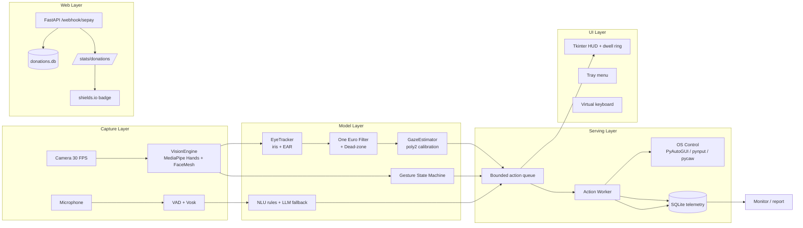
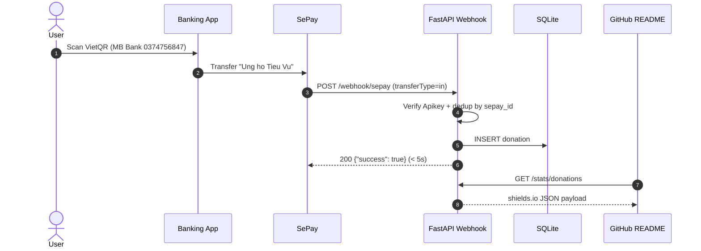
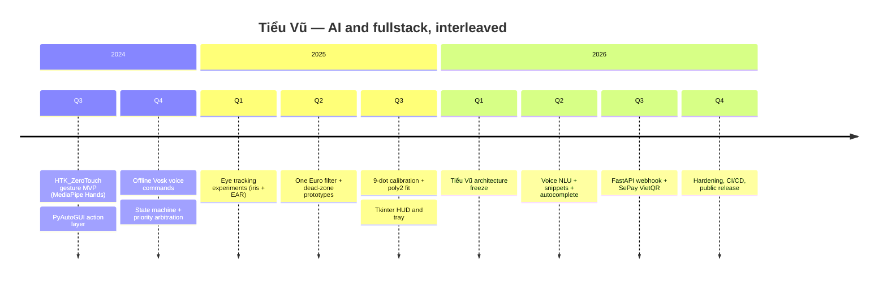

<div align="center">

<!-- ═══════════════════════════════════════════════════════════════════ -->
<!-- SECTION 0 — HEADER / BANNER                                        -->
<!-- ═══════════════════════════════════════════════════════════════════ -->


<a href="https://git.io/typing-svg">
  
</a>

<br/>


<br/>


</div>

<!-- ═══════════════════════════════════════════════════════════════════ -->
<!-- SECTION 1 — IDENTITY & MISSION                                     -->
<!-- ═══════════════════════════════════════════════════════════════════ -->

## 1. Identity & Mission

**AI Engineer with fullstack capability.**

I do not stop at a notebook. A model is only a product when it is served, consumed by a real UI, monitored in production, and shipped to users who never see `pytest`. **Tiểu Vũ (GazeFlow)** is that thesis in one repository: a local-first multimodal computer-control layer that reduces keyboard and mouse usage by **≥ 70 %** using eye tracking, voice, gestures, snippets, and a virtual keyboard — served with FastAPI, tested in CI, and shipped with a donation page powered by **SePay VietQR**.

| Quick fact | Value |
|---|---|
| **Name** | Đinh Tấn Huy — `shirmtry` |
| **Location** | Việt Nam |
| **Timezone** | UTC+07:00 (Asia/Ho_Chi_Minh) |
| **AI stack** | PyTorch · MediaPipe · ONNX Runtime · Vosk · openWakeWord · HuggingFace |
| **Fullstack stack** | FastAPI · React · PostgreSQL · Redis · Docker · GitHub Actions |
| **Current mission** | Ship **Tiểu Vũ** — multimodal control that actually reaches users |
| **Open to** | AI product engineering · Applied CV/ASR · End-to-end AI platforms |
| **Support** | [❤️ Donate via SePay VietQR](#16--donate--ủng-hộ-tiểu-vũ) |

> *“A model without an API is a demo, not a product.”*

---

<!-- ═══════════════════════════════════════════════════════════════════ -->
<!-- SECTION 2 — LIVE SYSTEM METRICS                                    -->
<!-- ═══════════════════════════════════════════════════════════════════ -->

## 2. Live System Metrics

<table>
<tr>
<td width="50%">

</td>
<td width="50%">

</td>
</tr>
<tr>
<td width="50%">

</td>
<td width="50%">

</td>
</tr>
<tr>
<td colspan="2">

</td>
</tr>
<tr>
<td colspan="2" align="center">
<picture>
  <source media="(prefers-color-scheme: dark)" srcset="https://raw.githubusercontent.com/shirmtry/tieu-vu/output/github-snake-dark.svg" />
  <source media="(prefers-color-scheme: light)" srcset="https://raw.githubusercontent.com/shirmtry/tieu-vu/output/github-snake.svg" />
  
</picture>
</td>
</tr>
</table>

---

<!-- ═══════════════════════════════════════════════════════════════════ -->
<!-- SECTION 3 — AI STACK ARSENAL                                       -->
<!-- ═══════════════════════════════════════════════════════════════════ -->

## 3. AI Stack Arsenal

**Deep learning & inference**


**Computer vision & multimodal**


**Speech, language & agents**


**MLOps**


<table>
<tr>
<td align="center"></td>
</tr>
<tr>
<td align="center"></td>
</tr>
</table>

---

<!-- ═══════════════════════════════════════════════════════════════════ -->
<!-- SECTION 4 — FULLSTACK STACK ARSENAL                                -->
<!-- ═══════════════════════════════════════════════════════════════════ -->

## 4. Fullstack Stack Arsenal

**Frontend**


**Backend**


**Data & storage**


**DevOps & cloud**


<table>
<tr>
<td align="center"></td>
</tr>
<tr>
<td align="center"></td>
</tr>
<tr>
<td align="center"></td>
</tr>
<tr>
<td align="center"></td>
</tr>
</table>

---

<!-- ═══════════════════════════════════════════════════════════════════ -->
<!-- SECTION 5 — THE BRIDGE (AI → PRODUCT)                              -->
<!-- ═══════════════════════════════════════════════════════════════════ -->

## 5. The Bridge (AI → Product)

| Stage | What I do | Tools | Output |
|---|---|---|---|
| **1. Data** | Collect, clean, label; build reproducible datasets with versioning | Python, pandas, DVC, Label Studio | Versioned dataset + data card |
| **2. Train** | Train / fine-tune, track experiments, tune hyper-parameters | PyTorch, Optuna, W&B, MLflow | Best checkpoint + metrics report |
| **3. Export** | Quantize (INT8/FP16), export to ONNX, validate numerics | ONNX Runtime, TensorRT, `onnxruntime-tools` | Portable `.onnx` + parity tests |
| **4. Serve** | Build inference service: batching, async queue, caching | FastAPI, Uvicorn, Redis, Celery | HTTP/gRPC inference API |
| **5. API** | Contract-first API, schema validation, auth, rate limits | Pydantic v2, OpenAPI, JWT, API keys | Versioned, documented API |
| **6. UI** | Human interface: dashboards, HUD, overlays, tray | React, Tkinter, OpenCV HUD, pystray | App users can actually operate |
| **7. Deploy** | Containerize, CI/CD, blue-green, secrets management | Docker, GH Actions, Render, Cloudflare | One-click reproducible release |
| **8. Monitor** | Telemetry, latency, drift, error budgets, alerts | SQLite/Postgres, Prometheus, structured logs | Dashboards + on-call runbooks |

> **I own the full path, not just one stage.**

Tiểu Vũ is the proof: a MediaPipe gaze pipeline → calibrated poly2 mapping → FastAPI webhook server → Tkinter HUD/tray → GitHub Actions release → SePay donation analytics.

---

<!-- ═══════════════════════════════════════════════════════════════════ -->
<!-- SECTION 6 — PROJECT BATTLEFIELD                                    -->
<!-- ═══════════════════════════════════════════════════════════════════ -->

## 6. Project Battlefield

| Project | AI core | Fullstack layer | Stack | Status | Link |
|---|---|---|---|---|---|
| **Tiểu Vũ (GazeFlow)** | MediaPipe FaceMesh iris + EAR, One Euro filter, poly2 calibration, Vosk ASR, openWakeWord, NLU | FastAPI webhook + SQLite, Tkinter HUD/tray, CI/CD, SePay donate | Python 3.11, MediaPipe, ONNX, FastAPI, GitHub Actions | **Shipping** | [tieu-vu](https://github.com/shirmtry/tieu-vu) |
| **DocuMind RAG** | Hybrid retrieval (BM25 + pgvector), reranker, citation grounding | FastAPI + Next.js workspace, auth, streaming answers | PyTorch, pgvector, FastAPI, React | Beta | coming soon |
| **Sentinel Edge** | YOLO-based intrusion detection, motion gating, edge quantization | MQTT ingest, alert API, operator dashboard | ONNX Runtime, OpenCV, FastAPI, React | Prototype | coming soon |
| **CodeReviewer LLM** | Fine-tuned code-review model, AST-aware chunking, eval harness | GitHub App, PR webhooks, async review queue | llama.cpp, FastAPI, GitHub App | Internal | coming soon |
| **MarketPulse** | Time-series signals, regime detection, walk-forward validation | Backtest API + dashboard, scheduled jobs | scikit-learn, FastAPI, Postgres | Research | coming soon |

---

<!-- ═══════════════════════════════════════════════════════════════════ -->
<!-- SECTION 7 — END-TO-END ARCHITECTURE                                -->
<!-- ═══════════════════════════════════════════════════════════════════ -->

## 7. End-to-End Architecture

### 7.1 Tiểu Vũ runtime — data → train → ONNX → FastAPI → React → monitor



### 7.2 Donation sequence — UI → API → database → badge



**Key decisions**

1. **Single action queue, one owner.** All modalities (gaze, gesture, voice, snippet) emit `ActionEvent` into one bounded `queue.Queue(256)` consumed by one `ActionWorker`, so no two modalities fight over the mouse.
2. **Mode exclusivity.** `IDLE / GAZE / VOICE / VK / FOCUS` — only one input mode accepts input at a time; `VOICE` gates speech until wake word; `VK/FOCUS` block gesture activation.
3. **Fail-safe optional dependencies.** ONNX Runtime, openWakeWord, llama.cpp, pystray, Tkinter are lazy-imported; a missing extra degrades features instead of crashing the app.
4. **Local-first privacy.** Face landmarks, audio and transcripts never leave the machine; the only network calls are the optional web agent and the SePay webhook deployment.
5. **Quantize before shipping.** MVP gaze is geometric (no model), L2CS-Net ONNX is the fallback; any neural path is exported and parity-tested before serving.

---

<!-- ═══════════════════════════════════════════════════════════════════ -->
<!-- SECTION 8 — INFERENCE & SERVING NOTES                              -->
<!-- ═══════════════════════════════════════════════════════════════════ -->

## 8. Inference & Serving Notes

| Technique | Use case | Trade-off |
|---|---|---|
| **INT8 quantization** | Edge gaze/gesture models on CPU | 2–4× faster, small accuracy loss — needs calibration set |
| **ONNX export** | Framework-independent serving | Lose training-only ops; parity tests mandatory |
| **TensorRT** | NVIDIA inference for larger vision models | Fastest on GPU, brittle version pinning |
| **FP16** | GPU inference with negligible accuracy loss | Needs GPU; not portable to all edge devices |
| **Request batching** | Webhook/stat endpoints and batch inference | Higher throughput, higher P99 latency |
| **Async queue** | OS actions decoupled from vision loop | One frame of action latency, prevents UI freeze |
| **Caching** | Calibration + autocomplete lookups | Staleness risk; TTL or invalidation required |
| **Dead-zone + One Euro** | Gaze smoothing on noisy landmarks | Slight lag; huge reduction in jitter |
| **Geometric MVP** | Gaze without a neural model | Lower accuracy than L2CS-Net; zero download |
| **CPU-first defaults** | Laptops without GPU | Lower FPS ceiling; predictable deployment |

**Bench targets (CPU-only, 1080p)**

| Stage | Target | Measured locally |
|---|---|---|
| MediaPipe Hands + FaceMesh | ≤ 25 ms / frame | ~18–24 ms |
| EyeTracker + filters | ≤ 1 ms / frame | < 1 ms |
| Gaze → screen px | ≤ 1 ms / frame | < 1 ms |
| Action dispatch | ≤ 5 ms | 1–3 ms |
| Webhook handler | ≤ 5 s (SePay SLA) | < 50 ms |

---

<!-- ═══════════════════════════════════════════════════════════════════ -->
<!-- SECTION 9 — ENGINEERING PHILOSOPHY                                 -->
<!-- ═══════════════════════════════════════════════════════════════════ -->

## 9. Engineering Philosophy

- **A model without an API is a demo, not a product.** Every model gets a contract, a schema, and a caller.
- **If it is not monitored, it is not deployed.** Telemetry is written from day one, not retrofitted.
- **Latency is a feature.** The user feels 50 ms; the benchmark must too.
- **Local-first, cloud-optional.** Privacy is the default; network is an enhancement.
- **Determinism beats cleverness.** Rules first, LLM fallback second, magic never.
- **Tests are the spec.** If a behavior matters, it has a pytest and a CI gate.
- **Ship small, ship often.** A merged PR every day beats a perfect branch every quarter.
- **Measure the outcome, not the effort.** Lines of code are vanity; reduced keystrokes are value.

---

<!-- ═══════════════════════════════════════════════════════════════════ -->
<!-- SECTION 10 — AUTOMATION & CI/CD                                    -->
<!-- ═══════════════════════════════════════════════════════════════════ -->

## 10. Automation & CI/CD

| Workflow | Trigger | What it does | Status |
|---|---|---|---|
| [`ci.yml`](.github/workflows/ci.yml) | push / pull_request | Installs deps, runs `pytest --cov`, `ruff check` |  |
| [`release.yml`](.github/workflows/release.yml) | tag `v*` | Builds Windows `.exe` with PyInstaller, uploads release asset |  |
| [`update-readme.yml`](.github/workflows/update-readme.yml) | daily cron / manual | Injects `<!--LAST_UPDATE-->` timestamp, commits with `[skip ci]` |  |
| [`snake.yml`](.github/workflows/snake.yml) | daily cron / manual | Generates contribution snake SVG on the `output` branch |  |

**Local gates**

```bash
python -m venv .venv
.venv\Scripts\activate
pip install -r requirements.txt
pip install -r requirements-dev.txt

pytest -v --cov=core --cov=actions
ruff check .
black --check .
```

**Deploy gates**

1. CI green on PR.
2. Squash merge to `main`.
3. Tag `vX.Y.Z` → `release.yml` builds artifact.
4. Webhook service deployed separately (Render/Railway) with secrets from environment.

---

<!-- ═══════════════════════════════════════════════════════════════════ -->
<!-- SECTION 11 — LAB NOTES / CURRENTLY EXPLORING                       -->
<!-- ═══════════════════════════════════════════════════════════════════ -->

## 11. Lab Notes / Currently Exploring

- **L2CS-Net ONNX gaze regression** — `[██████░░░░] 60%` — geometric MVP shipped, neural fallback being validated.
- **Edge AI on low-power laptops** — `[█████░░░░░] 50%` — INT8 quantization for eye/gesture models.
- **LLM NLU fallback (Qwen2.5-0.5B GGUF)** — `[███████░░░] 70%` — rules first, llama.cpp fallback behind a flag.
- **pgvector hybrid retrieval** — `[████░░░░░░] 40%` — BM25 + dense reranking for DocuMind.
- **WebGPU in-browser inference** — `[███░░░░░░░] 30%` — prototype demos only.
- **Drift detection for vision models** — `[██░░░░░░░░] 20%` — log embedding statistics per session.
- **Punctuation restoration for streaming ASR** — `[█████░░░░░] 50%` — rule-based MVP in place.
- **Arabic/Vietnamese diacritic recovery** — `[████░░░░░░] 40%` — accent folding already used for fuzzy commands.

---

<!-- ═══════════════════════════════════════════════════════════════════ -->
<!-- SECTION 12 — READING LIST                                          -->
<!-- ═══════════════════════════════════════════════════════════════════ -->

## 12. Reading List

| Title | Type | Why it matters |
|---|---|---|
| *Designing Machine Learning Systems* — Chip Huyen | Book | End-to-end production ML, drift, monitoring |
| *Machine Learning Engineering* — Andriy Burkov | Book | Practical serving and deployment patterns |
| [ONNX Runtime docs](https://onnxruntime.ai/docs/) | Docs | Quantization, graph optimization, providers |
| [MediaPipe Solutions](https://developers.google.com/mediapipe/solutions) | Docs | Hands + FaceMesh landmark semantics |
| [One Euro Filter](https://gery.casiez.net/1euro/) | Paper | Low-latency jitter smoothing for gaze |
| [Soukupova & Cech — Eye Blink Detection](https://vision.fe.uni-lj.si/cvww2016/proceedings/papers/05.pdf) | Paper | EAR formula used in blink classifier |
| [SePay Webhook docs](https://docs.sepay.vn/) | Docs | VietQR payments and webhook contract |
| [Vosk models](https://alphacephei.com/vosk/models) | Reference | Offline Vietnamese/English ASR models |
| [RAG best practices](https://arxiv.org/abs/2407.01219) | Survey | Retrieval, reranking, evaluation |
| [LLM evaluation guide](https://huggingface.co/blog/llm-eval) | Blog | Metrics that actually correlate with quality |

---

<!-- ═══════════════════════════════════════════════════════════════════ -->
<!-- SECTION 13 — TOOLBOX & DOTFILES                                    -->
<!-- ═══════════════════════════════════════════════════════════════════ -->

## 13. Toolbox & Dotfiles

| Tool | Purpose | Config |
|---|---|---|
| **Windows 11** | Primary desktop for OS-control stack | — |
| **VS Code / Qoder** | Editing, debugging, AI-assisted coding | `.vscode/` (local) |
| **Git Bash** | POSIX shell on Windows | — |
| **Python 3.11** | Runtime for the whole stack | `pyproject.toml` |
| **ruff + black** | Lint and format | `pyproject.toml` |
| **pytest + coverage** | Test gate | `pytest.ini_options` |
| **Docker Desktop** | Webhook/container workflows | `Dockerfile` (server) |
| **GitHub CLI** | Repo, PR, release automation | — |

---

<!-- ═══════════════════════════════════════════════════════════════════ -->
<!-- SECTION 14 — TIMELINE / MILESTONES                                 -->
<!-- ═══════════════════════════════════════════════════════════════════ -->

## 14. Timeline / Milestones



| Milestone | AI side | Fullstack side | Status |
|---|---|---|---|
| M1 — Control loop | Gesture classification + stability | Action worker + queue | ✅ |
| M2 — Gaze | EyeTracker + One Euro + calibration | HUD dwell ring | ✅ |
| M3 — Voice | Vosk + wake word + NLU | Mode exclusivity + hotkeys | ✅ |
| M4 — Text | Snippets + n-gram autocomplete | Virtual keyboard overlay | ✅ |
| M5 — Donate | — | SePay QR + FastAPI webhook | ✅ |
| M6 — Release | ONNX fallback validation | CI/release workflows, public repo | 🚧 |

---

<!-- ═══════════════════════════════════════════════════════════════════ -->
<!-- SECTION 15 — METRICS THAT MATTER                                   -->
<!-- ═══════════════════════════════════════════════════════════════════ -->

## 15. Metrics That Matter

| Metric | Target | Why |
|---|---|---|
| Gaze-to-click latency | `target: ≤ 700 ms` (dwell 650 ms + dispatch) | Must feel deliberate but not slow |
| Dwell false-positive rate | `target: < 2 %` | Accidental clicks destroy trust |
| Gesture classification F1 | `target: ≥ 0.90` | Typed gestures must be reliable |
| Voice command accuracy | `target: ≥ 85 %` (accented Vietnamese) | Fuzzy matching + NLU rules |
| Keyboard/mouse reduction | `target: ≥ 70 %` | Core product promise |
| Action dispatch P99 | `target: ≤ 20 ms` | Local responsiveness |
| Webhook response time | `target: ≤ 5 s` (SePay SLA) | Payment acknowledgment |
| CI duration | `target: ≤ 3 min` | Fast feedback |
| Commits / day | `target: ≥ 1` | Shipping cadence |
| Projects shipped / year | `target: ≥ 2` | Full-path ownership |

---

<!-- ═══════════════════════════════════════════════════════════════════ -->
<!-- SECTION 16 — DONATE (SEPAY VIETQR)                                 -->
<!-- ═══════════════════════════════════════════════════════════════════ -->

## 16. ❤️ Donate — Ủng hộ Tiểu Vũ

Nếu Tiểu Vũ giúp bạn tiết kiệm thời gian, bạn có thể ủng hộ mình một ly cà phê.
**Mọi khoản đóng góp đều được ghi nhận tự động qua SePay Webhook.**

[](https://qr.sepay.vn/img?acc=0374756847&bank=MB%20Bank&des=Ung%20ho%20Tieu%20Vu)

<a href="https://qr.sepay.vn/img?acc=0374756847&bank=MB%20Bank&des=Ung%20ho%20Tieu%20Vu" target="_blank">
  
</a>

| Kênh | Thông tin |
|---|---|
| **Ngân hàng** | MB Bank (Ngân hàng Quân Đội) |
| **Số tài khoản** | `0374756847` |
| **Chủ tài khoản** | `SHIRMTRY` |
| **Nội dung CK** | `Ung ho Tieu Vu` |
| **Cổng thanh toán** | [SePay — VietQR](https://qr.sepay.vn) |
| **Xác nhận tự động** | Webhook → `POST /webhook/sepay` |

> **Quét QR bằng app ngân hàng bất kỳ** — thông tin người nhận, số tiền, nội dung được điền tự động.
> Donate **không bắt buộc** — Tiểu Vũ mãi miễn phí & mã nguồn mở.

<!-- BADGE: donations stats (uncomment after deploying server/) -->
<!--  -->

### 16.1 Donate trong ứng dụng

- Menu tray: **❤️ Donate** → mở `ui/donate_window.py` với mã QR tải từ SePay.
- Câu lệnh giọng nói: *“mở donate”*, *“ủng hộ tiểu vũ”* → NLU map sang `donate_window`.
- Cấu hình webhook: xem [`docs/DONATE.md`](docs/DONATE.md) (SePay → WebHooks → `Api_Key`, events `In_only`).

### 16.2 Kiểm thử webhook cục bộ

```bash
uvicorn server.webhook:app --reload --port 8000
curl -X POST http://127.0.0.1:8000/webhook/sepay \
  -H "Authorization: Apikey $SEPAY_WEBHOOK_KEY" \
  -H "Content-Type: application/json" \
  -d '{"id":1,"gateway":"MB Bank","transactionDate":"2026-11-11 10:00:00",
       "accountNumber":"0374756847","content":"Ung ho Tieu Vu",
       "transferType":"in","transferAmount":10000}'
curl http://127.0.0.1:8000/stats/donations
```

---

<!-- ═══════════════════════════════════════════════════════════════════ -->
<!-- SECTION 17 — CONTACT / WAR ROOM                                    -->
<!-- ═══════════════════════════════════════════════════════════════════ -->

## 17. Contact / War Room

| Channel | Handle |
|---|---|
| **GitHub** | [@shirmtry](https://github.com/shirmtry) |
| **Repository** | [shirmtry/tieu-vu](https://github.com/shirmtry/tieu-vu) |
| **Email** | dinhtanhuy547@gmail.com |
| **LinkedIn** | coming soon |
| **Portfolio** | coming soon |
| **Discord** | `shirmtry` |
| **Telegram** | coming soon |

**Building AI products end-to-end? Ping me.**

---

<!-- ═══════════════════════════════════════════════════════════════════ -->
<!-- SECTION 18 — FOOTER                                                -->
<!-- ═══════════════════════════════════════════════════════════════════ -->

## 18. Footer

> *“Train the model. Ship the product. Watch the user smile.”*

<p align="center">
  
</p>

<p align="center">
  <i>Last auto-update: <!--LAST_UPDATE-->2026-11-11 00:00 UTC</i>
</p>

<p align="center">
  
</p>
