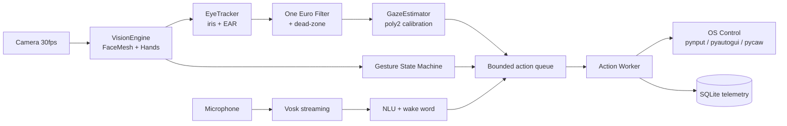

<div align="center">


**Control your computer with your eyes, voice, and gestures.**
Local-first · Offline · Low-latency · Open-source

[](https://github.com/shirmtry/tieu-vu/actions/workflows/ci.yml)
[](https://github.com/shirmtry/tieu-vu/actions/workflows/release.yml)
[](./LICENSE)
[](https://www.python.org/)
[%20%7C%20macOS%2FLinux%20(partial)-lightgrey.svg)](#-requirements)

[🚀 Quick Start](#-quick-start) · [✨ Features](#-features) · [🏗 Architecture](#-architecture) · [📖 Docs](#-documentation) · [❤️ Donate](#-donate)

</div>

---

## 📖 What is Tiểu Vũ?

**Tiểu Vũ (GazeFlow)** is a local-first multimodal computer-control layer
that lets you operate your computer **without touching the keyboard or mouse**:

- 👁️ **Eye tracking** — move the cursor, dwell-click, blink-click, edge-scroll
- 🎙️ **Voice** — dictate text, run commands, wake-word activation
- ✋ **Gestures** — pinch, palm, swipe, two-hand volume, desktop switching
- 🧠 **Snippets + autocomplete** — cut repetitive typing

Everything runs **offline on CPU** — no cloud, no telemetry sent out, no GPU required.

> Built on MediaPipe, Vosk, ONNX Runtime, and Tkinter.

---

## ✨ Features

| Feature | Description | Status |
|---|---|---|
| **Eye tracking** | MediaPipe FaceMesh 478 landmarks + iris, EAR for blink | ✅ |
| **Gaze → cursor** | Geometric eye-ratio + optional 9-dot poly2 calibration | ✅ |
| **Dwell click** | 650 ms dwell (R = 40 px) with progress-ring feedback | ✅ |
| **Blink click** | Long blink → left click, double blink → double click | ✅ |
| **Edge scroll** | Gaze at top/bottom 10 % with head-pitch guard + ramp | ✅ |
| **Hand gestures** | Pinch click, drag, right-click, palm, swipe | ✅ |
| **Two-hand control** | Volume, copy, open app, switch desktop | ✅ |
| **Virtual keyboard** | Transparent Tkinter overlay, dwell-select keys | ✅ |
| **Voice-to-text** | Vosk streaming (vi + en), insert via clipboard | ✅ |
| **Voice commands** | Fuzzy Vietnamese/English rule-based NLU | ✅ |
| **LLM NLU fallback** | Qwen2.5-0.5B GGUF via llama-cpp-python (optional) | 🚧 |
| **Wake word** | Vosk phrase matcher; openWakeWord optional | ✅ |
| **Snippets** | `;addr` → expand full text from config | ✅ |
| **Autocomplete** | Local n-gram, 3 suggestions, Tab accepts | ✅ |
| **Mode exclusivity** | IDLE / GAZE / VOICE / VK / FOCUS, one input at a time | ✅ |
| **Telemetry** | Local SQLite action log + stats | ✅ |
| **Donate** | SePay VietQR in-app + FastAPI webhook | ✅ |

---

## ⚡ Quick Start

### Requirements

- **Python 3.11+**
- **Webcam** (≥ 720p, 30 fps)
- **Microphone** (16 kHz) for voice features
- **OS:** Windows 10/11 (primary — `pycaw`, `run.bat`); macOS/Linux run the core/vision/voice stack with partial OS control

### Install

```bash
git clone https://github.com/shirmtry/tieu-vu.git
cd tieu-vu

python -m venv .venv
source .venv/bin/activate       # Linux/macOS
.venv\Scripts\activate          # Windows

pip install -r requirements.txt
```

### Download an ASR model (one-time)

Vosk models are not committed. Download a Vietnamese model from
[alphacephei.com/vosk/models](https://alphacephei.com/vosk/models) and extract it to
`models/` so that `config.yaml → voice.model_path` resolves (default
`models/vosk-model-vn-0.4`):

```bash
models/
└── vosk-model-vn-0.4/
```

Voice is optional — set `voice.enabled: false` in `config.yaml` if you have no microphone.

### Run

```bash
# One-time gaze calibration (9 dots, ~30 s)
python main.py --calibrate

# Normal run
python main.py

# Dev mode (camera preview + DEBUG logs)
python main.py --dev

# Headless (no preview window)
python main.py --no-preview
```

### Hotkeys

| Keys | Action |
|---|---|
| `Ctrl+Alt+G` | Toggle **GAZE** mode |
| `Ctrl+Alt+V` | Toggle **VOICE** mode |
| `Ctrl+Alt+K` | Toggle **VK** mode (virtual keyboard) |
| `Ctrl+Alt+F` | Toggle **FOCUS** mode (gestures blocked) |
| `Ctrl+Alt+P` | Pause / resume all actions |
| `Ctrl+Alt+Q` | Quit |
| `Esc` | Quit (when the preview window is focused) |

### Tray menu

Right-click the tray icon → *Tạm dừng / Tiếp tục · Hiệu chuẩn gaze · Donate · Thoát*.

---

## 🎮 Usage examples

**Click without touching the mouse**
> Look at a button for 650 ms → click fires. The HUD ring shows dwell progress.

**Type a sentence by voice**
> Say the wake word, then speak. The transcript is parsed into an action
> (search, type, open app, …) and executed through the shared action queue.

**Open a site by voice**
> "mở youtube" → NLU matches `open_url` → YouTube opens in the browser.

**Expand a snippet**
> Type `;addr` → expands to your saved address from `config.yaml`.

**Scroll a page**
> Look at the bottom 10 % of the screen with a neutral head pitch → smooth scroll starts.

**Donate**
> Tray → *❤️ Donate* (or say "mở donate") → SePay VietQR modal opens.

---

## 🏗 Architecture



**Design decisions**

- **Single action queue, one owner** — every modality emits `ActionEvent` into one
  bounded queue drained by one worker, so gaze, gestures, and voice never fight.
- **Mode exclusivity** — only one input mode accepts input at a time.
- **Fail-safe optional deps** — ONNX Runtime, openWakeWord, llama.cpp, pystray and
  Tkinter are lazy-imported; missing extras degrade features instead of crashing.
- **Local-first** — landmarks, audio, and transcripts never leave the machine.

See [`docs/ARCHITECTURE.md`](./docs/ARCHITECTURE.md) for the full design.

---

## 📁 Project structure

```
tieu-vu/
├── core/                  # perception + state (vision, gaze, voice, NLU)
├── actions/               # OS control (mouse, text, system, web)
├── ui/                    # Tkinter HUD, virtual keyboard, tray, donate window
├── server/                # FastAPI webhook for SePay donate
├── models/                # Vosk models (not committed — download manually)
├── tests/                 # pytest unit + integration (66 tests)
├── docs/                  # ARCHITECTURE, CALIBRATION, DONATE
├── config.yaml            # commands, snippets, dwell/gaze parameters
├── main.py                # entry point
└── requirements.txt
```

---

## 🧪 Development

```bash
pip install -r requirements-dev.txt

# Tests + coverage
pytest -v --cov=core --cov=actions

# Lint and format
ruff check .
black --check .

# Build a Windows .exe
pyinstaller --onefile --noconsole \
  --add-data "models;models" \
  --add-data "config.yaml;." \
  main.py
```

CI runs the same test and lint gates on every push and pull request
([`ci.yml`](./.github/workflows/ci.yml)).

---

## 📚 Documentation

| Doc | Content |
|---|---|
| [`docs/ARCHITECTURE.md`](./docs/ARCHITECTURE.md) | System design, data flow, trade-offs |
| [`docs/CALIBRATION.md`](./docs/CALIBRATION.md) | 9-dot wizard, poly2 fit, validation |
| [`docs/DONATE.md`](./docs/DONATE.md) | SePay webhook setup and testing |
| [`AGENTS.md`](./AGENTS.md) | Engineering contract and roadmap |

Contributions are welcome — open an [issue](https://github.com/shirmtry/tieu-vu/issues)
or send a pull request. Run `pytest -v` and `ruff check .` before opening a PR.

---

## ❤️ Donate

If Tiểu Vũ saves you time, you can buy me a coffee.
**All donations are recorded automatically via SePay Webhook.**

<a href="https://qr.sepay.vn/img?acc=0374756847&bank=MB%20Bank&des=Ung%20ho%20Tieu%20Vu" target="_blank">
  
</a>

| Channel | Info |
|---|---|
| **Bank** | MB Bank (Military Commercial Joint Stock Bank) |
| **Account** | `0374756847` |
| **Holder** | `SHIRMTRY` |
| **Memo** | `Ung ho Tieu Vu` |
| **Gateway** | [SePay VietQR](https://qr.sepay.vn) |
| **Auto-confirm** | Webhook → `POST /webhook/sepay` |

> Donate is **optional** — Tiểu Vũ stays free and open-source forever.

---

## 📄 License

[MIT](./LICENSE) © 2026 Đinh Tấn Huy (`shirmtry`)

---

## 🙏 Acknowledgements

- [MediaPipe](https://developers.google.com/mediapipe) — FaceMesh + Hands
- [Vosk](https://alphacephei.com/vosk/) — offline ASR
- [ONNX Runtime](https://onnxruntime.ai/) — inference
- [openWakeWord](https://github.com/dscripka/openWakeWord) — wake word
- [One Euro Filter](https://gery.casiez.net/1euro/) — gaze smoothing

---

<div align="center">

**Made with ❤️ in Việt Nam**

[⭐ Star this repo](https://github.com/shirmtry/tieu-vu) · [🐛 Report bug](https://github.com/shirmtry/tieu-vu/issues) · [💡 Request feature](https://github.com/shirmtry/tieu-vu/issues)

</div>
